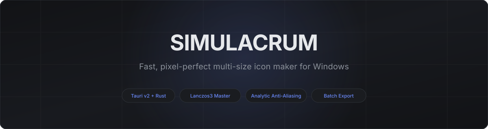
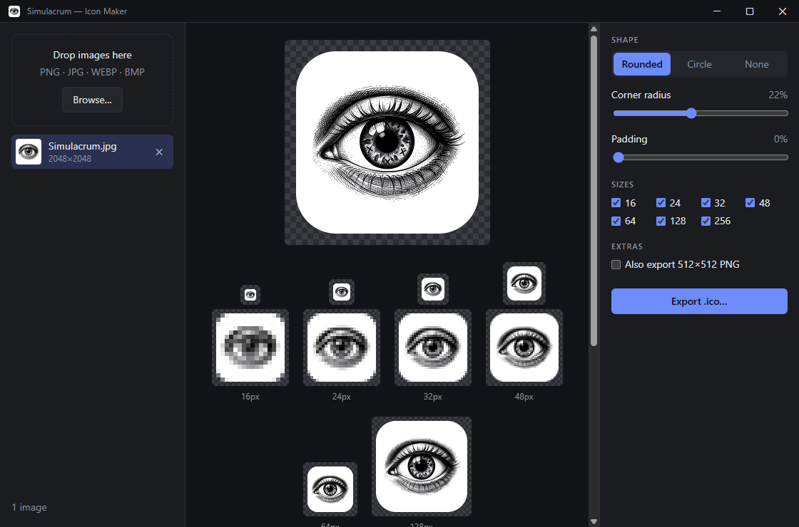
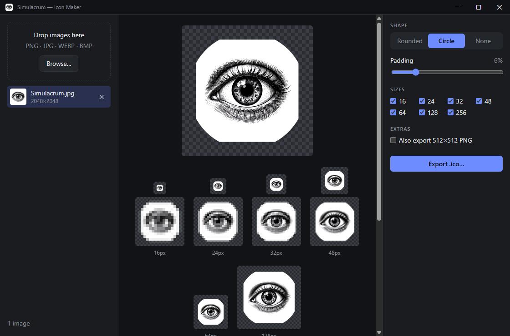
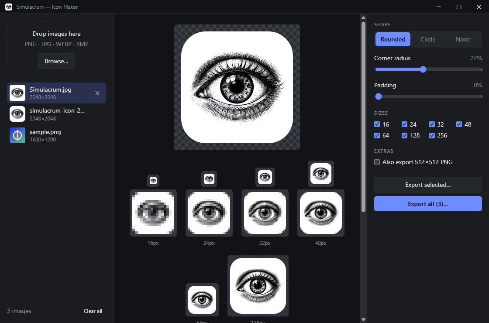
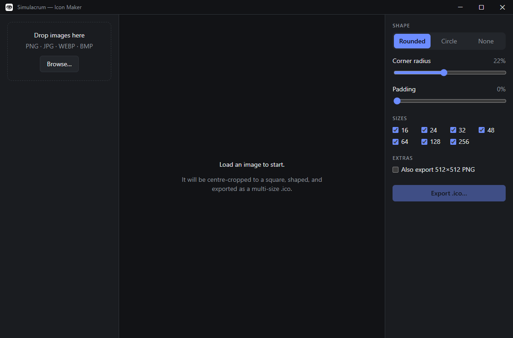
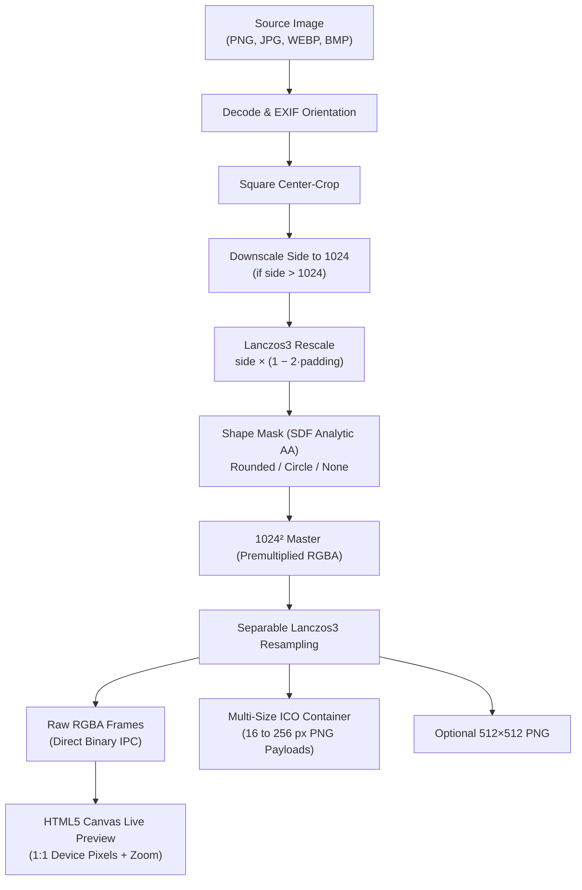

<div align="center">


# Simulacrum

**Fast, pixel-perfect multi-size icon maker for Windows**

[](https://github.com/projectGloria/Simulacrum/releases)
[](https://github.com/projectGloria/Simulacrum)
[](https://v2.tauri.app/)
[](https://www.rust-lang.org/)

<p align="center">
  
</p>

</div>

<p align="center">
  <a href="#about">About</a> •
  <a href="#features">Features</a> •
  <a href="#screenshots">Screenshots</a> •
  <a href="#how-it-works">How It Works</a> •
  <a href="#installation">Installation</a> •
  <a href="#usage">Usage</a> •
  <a href="#building-from-source">Building from Source</a> •
  <a href="#tests--verification">Verification</a>
</p>

---

## About

**Simulacrum** is a Windows desktop application built with Tauri v2, Rust, and TypeScript that transforms source graphics into anti-aliased, multi-resolution `.ico` icon files and companion PNGs.

Built for pixel perfection, Simulacrum eliminates the blurry scaling and dark fringe artifacts common in standard conversion tools. It generates output sizes strictly from a 1024² master using separable Lanczos3 resampling in premultiplied float RGBA space, streaming raw frames directly to an HTML5 canvas via binary IPC for zero-latency live previewing.

---

## Features

- **Multi-Format Ingestion**: Load PNG, JPG, WEBP, and BMP images via drag and drop or file browser, with automated square center-cropping and EXIF rotation correction.
- **Precision Geometric Masks**: Choose between **Rounded Square** (corner radius 0–50%, default 22%), **Circle** (analytic 50% radius), or **None** (unmasked square).
- **Per-Edge Artwork Padding**: Inset the artwork by 0–30% within the canvas while keeping the outer mask shape intact.
- **True Device-Pixel Live Preview**: Real-time rendering on a checkerboard canvas alongside a companion tray showing every selected size at 1:1 hardware device pixels plus integer-scaled pixelated zoom grids.
- **Selective Resolution Packing**: Select any combination of standard Windows icon sizes (16, 24, 32, 48, 64, 128, 256 px).
- **Batch Processing**: Queue multiple images simultaneously with directory export, progress reporting, failure detection, and automatic collision numbering (`icon-1.ico`).
- **High-Resolution Companion Export**: Option to emit a 512×512 master PNG alongside each `.ico`.
- **Persistent Preferences**: Remembers your preferred shapes, corner radii, padding, and size presets between launches.

---

## Screenshots

<p align="center">
  
  <br /><em>Main workspace: 512px master preview, live hardware-pixel zoom tray (16px–128px), and geometry sliders.</em>
</p>

<p align="center">
  
  <br /><em>Circle mask geometry with 6% artwork padding applied in real-time.</em>
</p>

<p align="center">
  
  <br /><em>Batch queue mode: multi-image queue management with bulk export controls.</em>
</p>

<p align="center">
  
  <br /><em>First launch: drag &amp; drop intake zone supporting single and multi-file imports.</em>
</p>

---

## How It Works

Preview and final file export execute against the exact same underlying Rust image pipeline (`src-tauri/src/pipeline.rs`). What you inspect in the preview window matches output pixels bit for bit.



### Core Architecture Highlights

- **Master Composition**: Images are decoded, center-cropped, and downscaled at most once to 1024px. The graphic is then placed on a transparent canvas and multiplied against an analytic signed-distance function (SDF) mask with 1-pixel linear anti-aliasing falloff (`mask.rs`).
- **No Cascading Downscaling**: Every output size (from 16px to 256px) is a single, direct Lanczos3 resample from the 1024² master. Lower resolutions are never downscaled from intermediary lower-resolution passes.
- **Premultiplied Alpha Geometry**: Resizing is evaluated strictly in premultiplied float RGBA space (`resample.rs`). Standard straight-alpha filtering allows black RGB values from transparent border pixels to bleed into translucent edges, generating a dark halo. Premultiplication guarantees zero edge fringing.
- **Zero-Copy IPC**: Canvas previews stream raw uncompressed RGBA bytes directly across Tauri's binary IPC bridge. No JSON serialization, Base64 conversion, or PNG encoding/decoding occurs on the slider interaction loop.
- **Strict ICO Conformance**: Handcrafted ICO container serialization (`ico.rs`). Directory entries are ordered in ascending resolution, capped at 256px (encoded as byte `0`), and populated with 32-bit RGBA PNG streams.

---

## Installation

### Prerequisites

| Component | Requirement |
|---|---|
| **Operating System** | Windows 10 (version 1809+) or Windows 11 (64-bit) |
| **WebView2 Runtime** | Preinstalled on Windows 11 and current Windows 10 (bootstrapped automatically if missing) |

### Prebuilt Binaries

Download the latest installer or portable executable from the [GitHub Releases](https://github.com/projectGloria/Simulacrum/releases) page:

- **NSIS Setup Installer**: `Simulacrum_1.0.0-beta.1_x64-setup.exe`
- **MSI Enterprise Installer**: `Simulacrum_1.0.0-beta.1_x64_en-US.msi`
- **Standalone Executable**: `simulacrum.exe`

---

## Usage

### Single Icon Generation

1. Launch **Simulacrum**.
2. Drag and drop any image (`.png`, `.jpg`, `.webp`, `.bmp`) onto the intake zone, or click **Browse…**.
3. Choose your desired **Shape** (`Rounded`, `Circle`, or `None`).
4. Adjust **Corner radius** (0–50%) and **Padding** (0–30%) while reviewing the 512px canvas and the live pixel zoom tray.
5. Select or deselect output sizes (`16`, `24`, `32`, `48`, `64`, `128`, `256`).
6. Optionally check **Also export 512×512 PNG**.
7. Click **Export .ico…** and choose your destination file.

### Batch Processing

1. Select and drag multiple images into the sidebar at once.
2. Click through individual thumbnails in the queue to inspect crops and set universal adjustments.
3. Click **Export all (N)…** and select an output folder.
4. Simulacrum processes each image concurrently across available CPU threads, writing non-conflicting files (`name.ico`, `name-1.ico`) with real-time progress indicators.

---

## Building from Source

### Prerequisites

- **Rust** (stable MSVC toolchain):
  ```bash
  rustup default stable-x86_64-pc-windows-msvc
  ```
- **Microsoft C++ Build Tools** (Visual Studio Installer → *Desktop development with C++*)
- **Node.js** ≥ 18 and **npm**

### Build Steps

1. **Clone the repository**:
   ```bash
   git clone https://github.com/projectGloria/Simulacrum.git
   cd Simulacrum
   ```

2. **Install frontend dependencies**:
   ```bash
   npm install
   ```

3. **Run the local development server** (starts Vite on port `1430` and boots the Tauri client):
   ```bash
   npm run tauri dev
   ```

4. **Compile production release packages**:
   ```bash
   npm run tauri build
   ```

Artifacts will be produced in `src-tauri/target/release/`:
- Executable: `src-tauri/target/release/simulacrum.exe`
- NSIS installer: `src-tauri/target/release/bundle/nsis/Simulacrum_1.0.0-beta.1_x64-setup.exe`
- MSI installer: `src-tauri/target/release/bundle/msi/Simulacrum_1.0.0-beta.1_x64_en-US.msi`

---

## Tests & Verification

### Running Automated Rust Tests

Run the test suite covering mask math, SDF falloffs, resampling, and edge fringe prevention:

```bash
cd src-tauri
cargo test --release
```

### Headless CLI Utility

Simulacrum includes a standalone CLI utility that exercises the exact same Rust rendering pipeline without the UI:

```bash
cd src-tauri
cargo run --release --example make_ico -- ../test-out/sample.png ../test-out/out.ico --shape rounded --radius 22 --sizes 16,32,256 --png
```

### Python Binary Header Inspection

Verify generated ICO headers, color depths, PNG magic signatures, and transparent boundary bounds using the included Pillow script:

```bash
python -I scripts/verify_ico.py test-out/out.ico --expect 16,32,256
```

### ImageMagick Identification

If ImageMagick is installed, verify container layers directly:

```bash
magick identify test-out/out.ico
```

---

## Project Layout

```
Simulacrum/
├── index.html                 # Main application DOM and title bar
├── src/                       # Frontend application code
│   ├── main.ts                # UI event bindings, state, and rendering
│   ├── api.ts                 # Strongly-typed Tauri IPC invoke wrappers
│   ├── settings.ts            # Local preferences and schema
│   └── styles.css             # Dark theme design system and layout
├── src-tauri/                 # Backend Rust engine
│   ├── Cargo.toml             # Rust package configuration and dependencies
│   ├── tauri.conf.json        # Tauri runtime, window, and security policy
│   ├── src/
│   │   ├── lib.rs             # Plugin registration and command entry points
│   │   ├── commands.rs        # Asynchronous IPC dispatch and batch worker
│   │   ├── pipeline.rs        # Decode, center-crop, compose, and render
│   │   ├── resample.rs        # Separable Lanczos3 in premultiplied float RGBA
│   │   ├── mask.rs            # SDF analytic anti-aliasing masks
│   │   ├── ico.rs             # Low-level 32-bit ICO container serializer
│   │   └── naming.rs          # Collision-safe output path resolution
│   ├── examples/              # make_ico headless CLI tool
│   └── tests/                 # Integration tests for pixel accuracy
├── docs/assets/               # Screenshots, banners, and icons for documentation
├── scripts/                   # Python verification and test image generator
└── assets/                    # Master brand artwork (2048x2048)
```

---

## Contributing

Contributions, bug reports, and suggestions are welcome!

1. Fork the repository.
2. Create a feature branch (`git checkout -b feature/amazing-feature`).
3. Commit your changes (`git commit -m "Add amazing feature"`).
4. Push to the branch (`git push origin feature/amazing-feature`).
5. Open a Pull Request.

---

## License

This project is licensed under the terms described in the repository. Please refer to individual source files or contact the maintainers for licensing and distribution inquiries.
